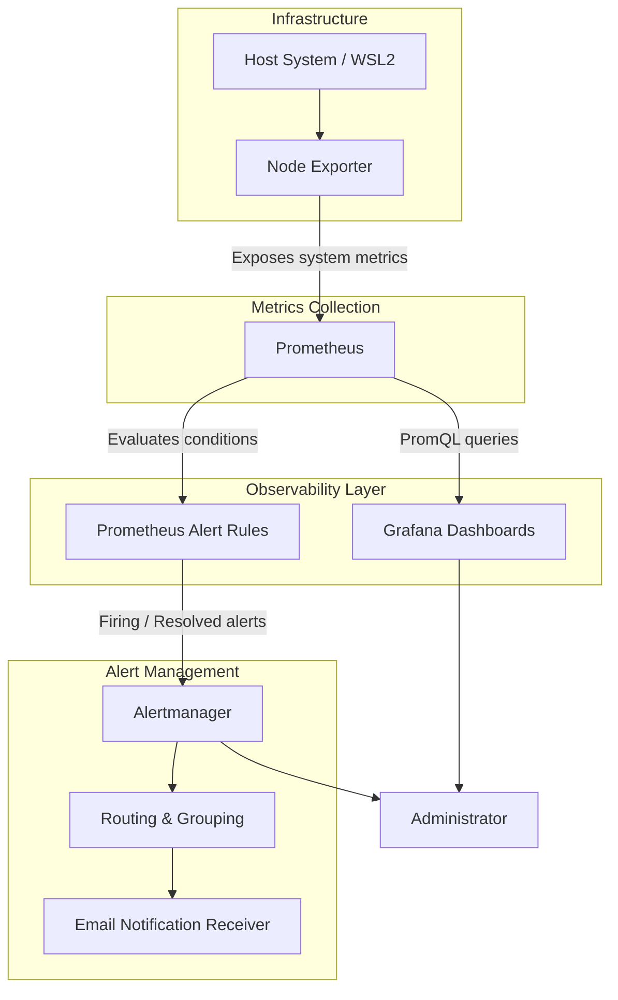
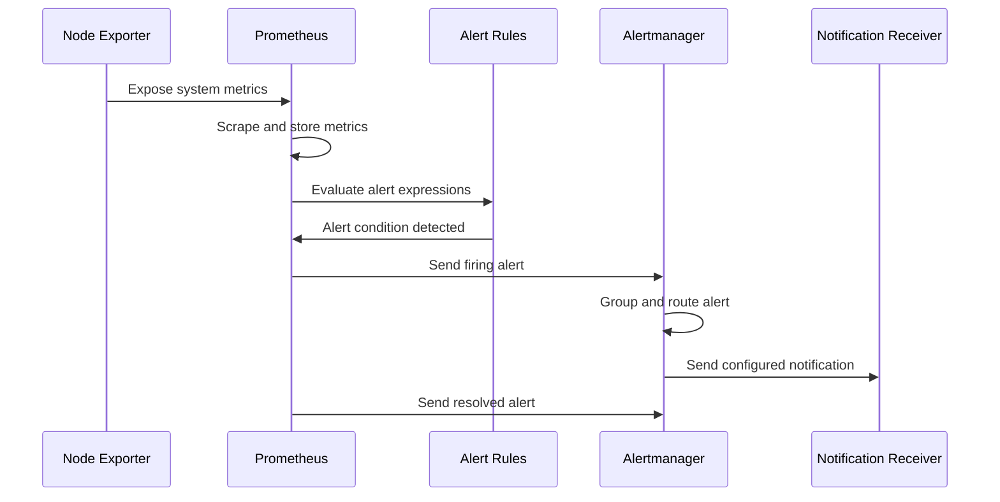

# SentinelOps 🚀
### A Containerized DevOps Monitoring & Observability Platform

<p align="center">
  
  
  
  
  
  
</p>

<p align="center">
  <b>Observe infrastructure. Detect anomalies. Respond with confidence.</b>
</p>

---

## 📌 Overview

What happens when a system starts running out of memory? What if disk utilization suddenly increases or a monitored service becomes unavailable? More importantly, how can we identify these problems before they lead to service disruptions?

**SentinelOps** was built to explore and address these challenges.

SentinelOps is a containerized infrastructure monitoring and observability platform that collects system-level metrics, visualizes infrastructure performance, evaluates alert conditions and manages alerts through a centralized monitoring stack.

Built using Docker Compose, Prometheus, Node Exporter, Grafana and Alertmanager, it provides real-time visibility into system health through interactive dashboards and configurable alert rules.

The goal was not simply to make monitoring dashboards, but to understand how monitoring systems collect data, identify abnormal conditions and communicate potential infrastructure problems.

## 🏗️ System Architecture



### Architecture workflow

1. **Node Exporter** exposes hardware and operating-system metrics.
2. **Prometheus** periodically scrapes configured monitoring targets and stores time-series data.
3. **Grafana** queries Prometheus using PromQL and displays system metrics through dashboards.
4. **Prometheus Alert Rules** continuously evaluate defined conditions.
5. **Alertmanager** receives firing and resolved alerts, groups them and routes them according to configured policies.
6. **Email notification routing** can deliver notifications when SMTP configuration is supplied.

## ✨ Key Features

### 1. Infrastructure Monitoring
- Real-time CPU utilization monitoring.
- Memory consumption and available RAM.
- Filesystem utilization and available disk space.
- Disk read/write throughput.
- Network receive and transmit traffic.
- Network packet rates.
- System uptime.
- CPU cores and system load averages.
- Process and file descriptor monitoring.

### 2. Interactive Grafana Dashboard

A centralized dashboard named **SentinelOps – System Overview** provides visibility into infrastructure health.

| Monitoring area | Metrics |
|---|---|
| Service Availability | Node Exporter, Prometheus, Grafana, Alertmanager |
| CPU | CPU usage, usage trends, CPU cores |
| Memory | RAM usage, available memory, memory trends |
| Disk | Disk utilization, free space, read/write throughput |
| Network | Receive/transmit traffic, packet rates |
| System | Uptime, load average, processes, file descriptors |

The dashboard supports automatic refresh and historical metric visualization.

### 3. Prometheus Alerting

Configurable alert rules are organized into monitoring categories:

- CPU alerts – High and critical CPU utilization.
- Memory alerts – High memory consumption.
- Disk alerts – Low disk space, critical disk space and disk capacity trends.
- Service availability alerts – Detection of unavailable monitoring targets.

Alerts support severity labels, descriptive annotations and configurable evaluation durations.

### 4. Alertmanager Integration

Alertmanager handles alerts received from Prometheus.

Implemented capabilities include:
- Warning and critical severity routing.
- Alert grouping.
- Notification receiver configuration.
- Firing and resolved alert handling.
- Configurable notification timing.
- Email notification templates and SMTP environment-variable configuration.

Actual email delivery requires valid SMTP credentials and a successful delivery test.

### 5. Containerized Infrastructure

All core monitoring components are orchestrated through Docker Compose.

Benefits:
- Consistent service deployment.
- Centralized configuration.
- Container health checks.
- Dedicated monitoring network.
- Persistent storage for monitoring data.
- Easier startup, shutdown and maintenance.

### 6. Monitoring Accuracy & Troubleshooting

During development, disk-space alerts were incorrectly triggered by irrelevant WSL2 filesystem mountpoints.

Instead of disabling the alerts, the filesystem filtering in the Prometheus alert expressions was corrected to monitor the intended root filesystem.

This eliminated the identified false positives while preserving disk monitoring.

## 🛠️ Technology Stack

| Technology | Purpose |
|---|---|
| Docker | Containerization |
| Docker Compose | Multi-container orchestration |
| Prometheus | Metrics collection and time-series storage |
| Node Exporter | Host system metrics |
| Grafana | Monitoring dashboards and visualization |
| Alertmanager | Alert grouping, routing and notifications |
| PromQL | Metrics querying and alert expressions |
| YAML | Infrastructure and monitoring configuration |
| Bash | Utility and health-check scripts |
| Git & GitHub | Version control and project hosting |

## 📂 Project Structure

```text
sentinalOps/
│
├── alertmanager/
│   ├── alertmanager.yml
│   └── templates/
│
├── grafana/
│   ├── dashboards/
│   └── provisioning/
│
├── prometheus/
│   ├── prometheus.yml
│   └── rules/
│       └── alert_rules.yml
│
├── scripts/
│   └── health_check.sh
│
├── .env.example
├── .gitignore
├── Makefile
├── docker-compose.yml
└── README.md
```

*The tree represents the intended organization of the repository. Refer to the actual repository for the complete file list.*

## ⚙️ Getting Started

### Prerequisites

Install the following:

- Docker Desktop
- Docker Compose
- Git
- WSL2 with Ubuntu (recommended for the Windows development environment)

Verify your installations:

```bash
docker --version
docker compose version
git --version
```

### 1. Clone the repository

```bash
git clone https://github.com/Chethana45/sentinalOps.git
```

Navigate into the project:

```bash
cd sentinalOps
```

### 2. Configure environment variables

Create your local environment file:

```bash
cp .env.example .env
```

On Windows PowerShell, you can use:

```powershell
Copy-Item .env.example .env
```

Edit `.env` and provide appropriate local configuration values.

Example variables:

```env
COMPOSE_PROJECT_NAME=sentinelops

GRAFANA_ADMIN_USER=admin
GRAFANA_ADMIN_PASSWORD=CHANGE_ME

GRAFANA_PORT=3000
PROMETHEUS_PORT=9090
ALERTMANAGER_PORT=9093
NODE_EXPORTER_PORT=9100

PROMETHEUS_RETENTION_TIME=15d

SMTP_HOST=
SMTP_PORT=587
SMTP_USERNAME=
SMTP_PASSWORD=
SMTP_FROM=
ALERT_EMAIL_TO=
```

Use the actual variable names defined in the repository's `.env.example` and Docker Compose configuration. Do not commit your `.env` file.

### 3. Start the monitoring stack

```bash
docker compose up -d
```

Check running containers:

```bash
docker compose ps
```

View service logs:

```bash
docker compose logs -f
```

View logs for a specific service:

```bash
docker compose logs -f prometheus
docker compose logs -f grafana
docker compose logs -f alertmanager
docker compose logs -f node-exporter
```

### 4. Access the services

Once the containers are running, open the following URLs:

| Service | URL |
|---|---|
| Grafana | http://localhost:3000 |
| Prometheus | http://localhost:9090 |
| Prometheus Targets | http://localhost:9090/targets |
| Prometheus Alerts | http://localhost:9090/alerts |
| Alertmanager | http://localhost:9093 |
| Node Exporter Metrics | http://localhost:9100/metrics |

Grafana credentials are configured using the environment variables in your local `.env` file.

### 5. Stop the monitoring stack

```bash
docker compose down
```

To stop the stack and remove its named volumes, use:

```bash
docker compose down -v
```

**Warning:** The second command deletes persisted monitoring data. Use it only when you intentionally want to reset the environment.

## 📊 PromQL Examples

Some of the PromQL expressions used for system monitoring:

### CPU Utilization

```promql
100 * (
  1 - avg by(instance) (
    rate(node_cpu_seconds_total{mode="idle"}[5m])
  )
)
```

### Memory Utilization

```promql
100 * (
  1 -
  node_memory_MemAvailable_bytes /
  node_memory_MemTotal_bytes
)
```

### Available Memory

```promql
node_memory_MemAvailable_bytes
```

### Disk Utilization – Root Filesystem

```promql
100 * (
  1 -
  (
    node_filesystem_free_bytes{
      mountpoint="/",
      fstype!~"tmpfs|devtmpfs|overlay",
      device!=""
    }
    /
    node_filesystem_size_bytes{
      mountpoint="/",
      fstype!~"tmpfs|devtmpfs|overlay",
      device!=""
    }
  )
)
```

### Network Receive Rate

```promql
rate(node_network_receive_bytes_total[5m])
```

### Network Transmit Rate

```promql
rate(node_network_transmit_bytes_total[5m])
```

### System Uptime

```promql
time() - node_boot_time_seconds
```

### Target Availability

```promql
up
```

Metric labels and filesystem filters may need adjustment depending on the host environment.

## 🔔 Alerting Workflow

SentinelOps uses Prometheus and Alertmanager to manage infrastructure alerts.



### Example alert scenarios

| Scenario | Severity |
|---|---|
| High CPU utilization | Warning |
| Critical CPU utilization | Critical |
| High memory utilization | Warning |
| Low disk space | Warning |
| Critical disk space | Critical |
| Monitoring target unavailable | Critical |

Thresholds and evaluation durations are defined in the Prometheus rule configuration.

## 🧪 Validation & Testing

The monitoring environment was validated through:

- Docker Compose configuration validation.
- Container startup and health checks.
- Prometheus target availability checks.
- Grafana dashboard verification.
- Live CPU, RAM, disk and network metric visualization.
- Prometheus alert rule evaluation.
- Disk alert filesystem-filtering correction.
- Alertmanager integration inspection.
- Alert lifecycle testing and cleanup.

The final observed Prometheus alert state during development was 12 inactive alerts, 0 pending alerts and 0 firing alerts.

## 🔐 Security Considerations

- Keep `.env` out of version control.
- Use `.env.example` for placeholder configuration.
- Never commit SMTP passwords or administrator credentials.
- Use strong Grafana administrator credentials.
- Restrict access to monitoring endpoints in production.
- Avoid exposing Prometheus and Node Exporter publicly without appropriate access controls.
- Use Docker secrets or a secure secret manager for production deployments.
- Rotate credentials if they have ever been exposed.

## 🧠 What I Learned

Building SentinelOps helped me gain practical experience in:

- Containerization and Docker Compose orchestration.
- Infrastructure monitoring and observability concepts.
- Prometheus metrics collection and time-series monitoring.
- Writing PromQL queries.
- Building Grafana dashboards.
- Designing alert rules and managing alert severity.
- Alertmanager routing and notification configuration.
- Debugging false-positive alerts.
- Working with WSL2 and Docker Desktop.
- Managing infrastructure configuration using YAML and environment variables.

One of my biggest takeaways was that a monitoring system is only useful when its alerts are accurate. Troubleshooting false positives was just as important as implementing the monitoring stack itself.

## 🚀 Future Enhancements

Potential extensions for SentinelOps include:

- Cloud infrastructure monitoring.
- Kubernetes monitoring.
- Custom application metrics.
- Centralized log aggregation using Loki.
- Distributed tracing using OpenTelemetry.
- CI/CD integration.
- Infrastructure provisioning with Terraform.
- Advanced anomaly detection.

## 👩‍💻 Author

**Chethana Sri**

BE Computer Science Engineering  
Madras Institute of Technology, Anna University

- GitHub: [@Chethana45](https://github.com/Chethana45)
- Project: [SentinelOps](https://github.com/Chethana45/sentinalOps)

---

<p align="center">
  <b>Built to understand infrastructure, not just monitor it.</b>
  <br/>
  If you find this project useful, consider giving the repository a ⭐
</p>
