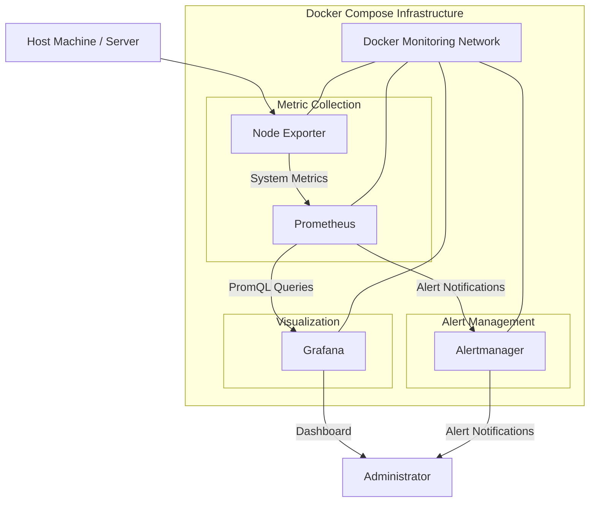

# 🛡️ SentinelOps — DevOps Server Monitoring & Observability Platform

<p align="center">
  
  
  
  
  
</p>

<p align="center">
  <b>Monitor. Detect. Visualize. Respond.</b>
</p>

SentinelOps is a containerized DevOps server monitoring and observability platform designed to monitor system infrastructure, collect real-time performance metrics, visualize resource utilization, and establish an extensible foundation for proactive infrastructure monitoring.

The project integrates Docker, Prometheus, Node Exporter, Grafana, and Alertmanager into a unified monitoring architecture.

Rather than manually checking server performance, SentinelOps provides a centralized monitoring environment to observe infrastructure health and identify potential resource bottlenecks.

---

## 📌 Table of Contents

- Overview
- Problem Statement
- Project Objectives
- System Architecture
- Technology Stack
- Core Components
- Monitoring Capabilities
- Environment Configuration
- Project Structure
- Installation and Setup
- Running the Infrastructure
- Accessing Services
- Prometheus Queries
- Verification and Testing
- Security Practices
- Future Enhancements
- Learning Outcomes

---

## 🚀 Overview

Modern infrastructure consists of multiple services that need continuous monitoring to maintain availability, performance, and reliability.

SentinelOps addresses this requirement by combining an open-source monitoring stack with containerized deployment.

The platform provides:

- Containerized monitoring infrastructure using Docker Compose.
- System-level metric collection using Node Exporter.
- Time-series metric collection and storage using Prometheus.
- Infrastructure visualization through Grafana.
- Alert management through Alertmanager.
- Environment-based configuration and credential management.
- Persistent storage for monitoring data.
- Automated datasource and dashboard provisioning.

The architecture is designed to be modular, maintainable, and extensible.

## 🎯 Problem Statement

Monitoring infrastructure manually becomes difficult as the number of services and system resources increases.

Without centralized monitoring, identifying CPU bottlenecks, memory exhaustion, disk capacity issues, network traffic fluctuations, and service failures becomes challenging.

SentinelOps aims to simplify infrastructure observability by bringing metric collection, visualization, and alert management into a single environment.

## 🏗️ System Architecture

SentinelOps follows a containerized monitoring architecture where individual services communicate through a dedicated Docker network.



### Architecture Workflow

1. **Node Exporter:** Collects system-level metrics such as CPU, memory, disk, and network statistics.
2. **Prometheus:** Periodically scrapes metrics from configured monitoring targets and stores them as time-series data.
3. **Grafana:** Connects to Prometheus and transforms collected metrics into interactive monitoring dashboards.
4. **Alertmanager:** Handles alerts generated by Prometheus alerting rules and manages notification routing.
5. **Docker Compose:** Orchestrates the monitoring services, networking, persistent volumes, and deployment configuration.

## 🧰 Technology Stack

| Technology | Purpose |
|---|---|
| Docker | Containerization |
| Docker Compose | Multi-container orchestration |
| Prometheus | Metrics collection and storage |
| Node Exporter | Host-level metrics |
| Grafana | Monitoring dashboards |
| Alertmanager | Alert management |
| YAML | Infrastructure configuration |
| Linux / Ubuntu WSL | Development environment |
| Git & GitHub | Version control |

## ⚙️ Core Components

### 1. Docker Infrastructure

Docker Compose manages the monitoring services through a centralized configuration.

Key responsibilities:

- Service orchestration.
- Container networking.
- Persistent volumes.
- Health checks.
- Restart policies.
- Port mapping.
- Environment variable integration.

### 2. Prometheus — Metrics Collection

Prometheus periodically collects metrics from configured targets.

Example scrape configuration:

```yaml
global:
  scrape_interval: 15s
  evaluation_interval: 15s

scrape_configs:
  - job_name: prometheus
    static_configs:
      - targets: ['localhost:9090']

  - job_name: node-exporter
    static_configs:
      - targets: ['node-exporter:9100']

  - job_name: alertmanager
    static_configs:
      - targets: ['alertmanager:9093']

  - job_name: grafana
    static_configs:
      - targets: ['grafana:3000']
```

### 3. Node Exporter — System Monitoring

Node Exporter exposes hardware and operating-system metrics for Prometheus to collect.

Metrics include:

- CPU utilization.
- Memory availability.
- Disk capacity.
- Filesystem utilization.
- Network traffic.
- System uptime.

### 4. Grafana — Visualization

Grafana provides a centralized interface for infrastructure monitoring.

The planned SentinelOps System Overview dashboard includes:

| Dashboard Panel | Description |
|---|---|
| CPU Usage | CPU utilization percentage |
| RAM Usage | Memory utilization percentage |
| Available Memory | Remaining system memory |
| Total Memory | Total available physical memory |
| Disk Usage | Filesystem utilization |
| Available Disk Space | Remaining filesystem capacity |
| Network Received | Incoming network traffic |
| Network Transmitted | Outgoing network traffic |
| System Uptime | Time since system boot |
| Server Availability | Monitoring target availability |

Dashboard provisioning is used to make the datasource and dashboard configuration repeatable.

### 5. Alertmanager — Alert Management

Alertmanager provides centralized alert handling.

It supports:

- Alert grouping.
- Alert routing.
- Notification management.
- Alert deduplication.
- Integration with external notification channels.

Email notifications can be configured through SMTP environment variables.

---

## 🔐 Environment Variables and Configuration

SentinelOps uses environment variables to separate deployment configuration and sensitive credentials from the main Docker Compose configuration.

### Configuration Files

| File | Purpose |
|---|---|
| `.env` | Local environment variables and credentials |
| `.env.example` | Example configuration template |
| `.gitignore` | Prevents sensitive and temporary files from being committed |
| `docker-compose.yml` | Infrastructure configuration |

### Example `.env.example`

```env
# Project Configuration
COMPOSE_PROJECT_NAME=sentinelops

# Grafana Authentication
GRAFANA_ADMIN_USER=admin
GRAFANA_ADMIN_PASSWORD=CHANGE_ME

# Service Ports
GRAFANA_PORT=3000
PROMETHEUS_PORT=9090
ALERTMANAGER_PORT=9093
NODE_EXPORTER_PORT=9100

# Prometheus Configuration
PROMETHEUS_RETENTION_TIME=15d

# Optional SMTP Configuration
ALERT_EMAIL_TO=
SMTP_HOST=
SMTP_PORT=
SMTP_USERNAME=
SMTP_PASSWORD=
SMTP_FROM=
```

### Environment Setup

Create your local environment file:

```bash
cp .env.example .env
```

Edit the configuration:

```bash
nano .env
```

Replace placeholder credentials with your own values.

**Security note:** The actual `.env` file must never be committed to GitHub. Only `.env.example` should be shared.

Environment variables allow configuration to change without repeatedly editing infrastructure files.

---

## 📁 Project Structure

```text
sentinelOps/
│
├── docker-compose.yml
├── .env.example
├── .gitignore
├── README.md
│
├── prometheus/
│   ├── prometheus.yml
│   └── rules/
│       └── alert-rules.yml
│
├── grafana/
│   ├── provisioning/
│   │   ├── datasources/
│   │   │   └── prometheus.yml
│   │   │
│   │   └── dashboards/
│   │       └── dashboards.yml
│   │
│   └── dashboards/
│       └── sentinelops-dashboard.json
│
├── alertmanager/
│   └── alertmanager.yml
│
└── scripts/
    └── *.sh
```

*The structure represents the intended configuration layout; retain the actual filenames and folders used in the repository.*

---

## 💻 Installation and Setup

### Prerequisites

Install the following:

- Docker Desktop
- WSL2
- Ubuntu
- Git
- Docker Compose

Verify Docker installation:

```bash
docker --version
docker compose version
```

### Step 1 — Clone the Repository

```bash
git clone https://github.com/Chethana45/sentinelOps.git

cd sentinelOps
```

### Step 2 — Configure Environment Variables

```bash
cp .env.example .env

nano .env
```

Configure the credentials and ports.

### Step 3 — Validate Docker Compose

```bash
docker compose config
```

This checks the resolved Compose configuration.

### Step 4 — Start the Infrastructure

```bash
docker compose up -d
```

### Step 5 — Verify Running Containers

```bash
docker compose ps
```

### Step 6 — Inspect Container Logs

```bash
docker compose logs -f
```

Inspect individual services:

```bash
docker compose logs prometheus

docker compose logs grafana

docker compose logs alertmanager

docker compose logs node-exporter
```

---

## 🌐 Accessing SentinelOps Services

Once the containers are running, access the services through your browser.

| Service | URL |
|---|---|
| Grafana Dashboard | http://localhost:3000 |
| Prometheus | http://localhost:9090 |
| Prometheus Targets | http://localhost:9090/targets |
| Prometheus Alerts | http://localhost:9090/alerts |
| Alertmanager | http://localhost:9093 |
| Node Exporter Metrics | http://localhost:9100/metrics |

Grafana credentials are configured through the local environment file.

---

## 📊 Prometheus Query Examples

SentinelOps uses PromQL to retrieve and analyze infrastructure metrics.

Some useful queries include:

**CPU Usage Percentage**

```promql
100 * (1 - avg by(instance) (
  rate(node_cpu_seconds_total{mode="idle"}[5m])
))
```

**RAM Usage Percentage**

```promql
100 * (
  1 -
  node_memory_MemAvailable_bytes /
  node_memory_MemTotal_bytes
)
```

**Available Memory**

```promql
node_memory_MemAvailable_bytes
```

**Disk Usage Percentage**

```promql
100 * (
  1 -
  node_filesystem_avail_bytes{
    fstype!~"tmpfs|overlay"
  } /
  node_filesystem_size_bytes{
    fstype!~"tmpfs|overlay"
  }
)
```

**Network Received Traffic**

```promql
rate(node_network_receive_bytes_total[5m])
```

**Network Transmitted Traffic**

```promql
rate(node_network_transmit_bytes_total[5m])
```

**System Uptime**

```promql
time() - node_boot_time_seconds
```

**Server Availability**

```promql
up
```

These queries should be validated against the metrics and labels exposed by the actual monitoring environment before being used in dashboard panels.

---

## 🧪 Verification and Testing

SentinelOps uses the following checks to validate infrastructure functionality.

### Docker Infrastructure

```bash
docker compose config

docker compose ps
```

### Prometheus Target Verification

Navigate to:

http://localhost:9090/targets

Verify that all configured scrape targets are UP.

Expected targets:

- Prometheus
- Node Exporter
- Grafana
- Alertmanager

### Prometheus Metrics Verification

Navigate to:

http://localhost:9090/graph

Execute queries such as:

```promql
up
```

### Grafana Verification

Navigate to:

http://localhost:3000

Verify:

- Prometheus datasource connectivity.
- Dashboard provisioning.
- Actual metric availability.
- Dashboard panel rendering.
- Automatic refresh.

### Container Persistence

Restart the infrastructure:

```bash
docker compose restart
```

Verify that persistent monitoring data and provisioned dashboards remain available.

---

## 🔒 Security Practices

SentinelOps follows basic infrastructure security practices:

- Environment-based credential management.
- `.env` exclusion from Git.
- `.env.example` for safe configuration sharing.
- No hardcoded production passwords.
- Dedicated Docker monitoring network.
- Persistent volumes for monitoring data.
- Restricted access to monitoring services.
- Optional SMTP credentials for notifications.

Never publish actual credentials, tokens, or passwords in public repositories.

---

## 🚧 Future Enhancements

Potential improvements for SentinelOps include:

- [ ] Advanced infrastructure alerting rules.
- [ ] Email and Telegram notifications.
- [ ] Container-level resource monitoring.
- [ ] Multi-server monitoring.
- [ ] Centralized log aggregation using Loki.
- [ ] Automated infrastructure health reports.
- [ ] CI/CD pipeline using GitHub Actions.
- [ ] Automated deployment to cloud infrastructure.
- [ ] Kubernetes monitoring integration.
- [ ] Role-based dashboard access.
- [ ] Infrastructure anomaly detection.

---

## 📚 Learning Outcomes

Building SentinelOps provides practical experience with:

- Docker containerization and orchestration.
- Linux and WSL2 environments.
- Infrastructure as Code concepts.
- Prometheus metric collection.
- PromQL query development.
- Grafana dashboard configuration.
- Alertmanager integration.
- Environment variable management.
- Docker networking and persistent volumes.
- Infrastructure troubleshooting.
- Git and GitHub workflows.

---

## 👩‍💻 Author

**Chethana Sri**

Computer Science Engineering Student  
Interested in DevOps, Cloud Computing, Full-Stack Development, and Infrastructure Engineering.

<p align="left">
  <a href="https://github.com/Chethana45">
    
  </a>
</p>

---

<p align="center">
  <b>SentinelOps — Building visibility into infrastructure, one metric at a time.</b>
</p>
